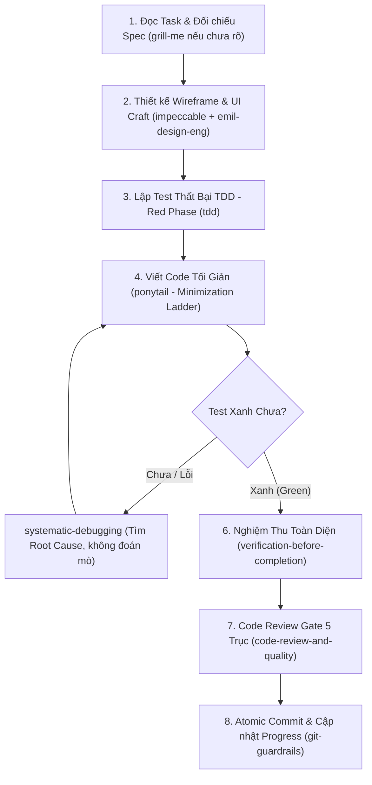

# 🦅 DoVe Master Orchestrator: Nhạc Trưởng Điều Phối Kỷ Luật Thép

> **Chào mừng đến với Trọng tâm Điều hành của Dự án DoVe (Dò Vé Số Kiến Thiết Miền Nam).**  
> Skill Mẹ này đóng vai trò như một **Senior Principal Engineer & Design Director**, chịu trách nhiệm điều phối hơn 30+ skills con đã cài đặt trong workspace, đảm bảo mọi dòng code, mọi màn hình giao diện, mọi query database và mọi commit đều đạt chuẩn **Production-Grade**, sạch bóng **AI-Slop** và **Code Bloat**.

---

## 🏛️ 1. Bản Đồ Tổng Quan Dự Án DoVe

- **Tên dự án:** DoVe (Dò Vé Số Kiến Thiết Miền Nam).
- **Mục tiêu cốt lõi:** Ứng dụng tra cứu kết quả xổ số kiến thiết miền Nam nhanh (< 5 giây), chính xác 100%, bảo vệ quyền riêng tư tuyệt đối (vé lưu offline trên máy qua AsyncStorage), hoàn toàn không cờ bạc/soi cầu.
- **Tech Stack chuẩn:**
  - **Backend:** Java 21 (LTS), Spring Boot 3, Maven (`mvnw`), Kiến trúc Hexagonal (Domain, Application, Adapters), PostgreSQL 16, Flyway, Jsoup (Scraper), Testcontainers, JUnit 5, AssertJ.
  - **Mobile App:** React Native + Expo (TypeScript), Expo Router (Tabs-based), NativeWind v4 (Tailwind), React Native Reanimated + Gesture Handler, Be Vietnam Pro font, Lucide icons, Expo Haptics, TanStack Query, AsyncStorage.
  - **Hạ tầng & CI/CD:** Docker multi-stage, docker-compose, GitHub Actions, EAS Build & EAS Update.
- **Quy mô:** 8 Phase, 179 task chi tiết (`docs/plans/PLAN-00-overview.md` đến `PLAN-08-quality-release.md`), theo dõi qua `docs/progress/`.
- **Kỷ luật cốt tử:** **1 Task = 1 Commit**, tuân thủ Conventional Commits 1.0, cập nhật file `PROGRESS-XX.md` ngay sau mỗi commit.

---

## 🗺️ 2. Ma Trận Điều Phối Skill Con (Child Skills Dispatch Matrix)

Mỗi khi tiếp nhận một yêu cầu hoặc task cụ thể, Nhạc Trưởng kích hoạt chính xác các skill con chuyên trách theo ma trận sau:

| Giai đoạn & Lĩnh vực | Skill Con Phụ Trách | Thời điểm kích hoạt & Nhiệm vụ |
|---|---|---|
| **Làm rõ yêu cầu & Edge-cases** | `grill-me` | Khi chuẩn bị làm task mới hoặc spec chưa rõ: AI đóng vai Tech Lead phỏng vấn ngược lại bạn, đào sâu mọi góc khuất, ràng buộc kỹ thuật. |
| **Lập & Thực thi kế hoạch** | `writing-plans`<br>`executing-plans` | Chia nhỏ task thành các vi-bước 2-5 phút thực thi, xác định rõ file cần sửa, test cần viết, nghiệm thu tuần tự không nhảy cóc. |
| **Sơ đồ Kiến trúc & UML 2.x** | `drawio-skill` | Khi thiết kế module mới, quan hệ thực thể, luồng dữ liệu: vẽ sơ đồ UML chuẩn quốc tế (Class, Sequence, ERD, C4), xuất file `.drawio` hoặc PlantUML/Mermaid trực quan. |
| **Giao diện & Diệt AI-Slop (TRỌNG TÂM)** | `impeccable`<br>`web-design-guidelines`<br>`frontend-design`<br>`wireframe-spec`<br>`ui-ux-pro-max` | **Cấm triệt để AI-Slop**: cấm gradient tím lòe loẹt, cấm card lồng card, cấm bo góc vô hồn, cấm tương phản kém. Duy trì `DESIGN.md` & `PRODUCT.md`. Dùng `/impeccable audit` và `/impeccable polish` để rà soát pixel-perfect. |
| **Micro-Interactions & Cảm giác App** | `emil-design-eng` | Chuyên sâu Spring Physics cho animation (Reanimated), cảm giác rung xúc giác chân thật (`expo-haptics`) khi bấm nút Dò, khi điền đủ 6 số OTP, hoặc khi trúng giải. |
| **Database 3NF & PostgreSQL** | `database-schema-designer`<br>`supabase-postgres-best-practices` | Chuẩn hóa schema 3NF, audit Foreign Keys, composite index cho `(station_id, draw_date DESC)`, locking chống race condition (`SELECT ... FOR UPDATE`), cursor pagination. |
| **Tối giản Mã Nguồn (Anti-Code-Bloat)** | `ponytail` | Kỷ luật **The Minimization Ladder 7 nấc**: YAGNI -> tái sử dụng -> standard library -> native API -> cấm cài thêm thư viện khi Expo/Web API đã có sẵn. |
| **Kỷ luật TDD (Test-Driven)** | `test-driven-development`<br>`tdd` | **Bất di bất dịch:** Viết Unit Test đỏ (Red) -> Chạy test xác nhận FAIL -> Viết code tối giản vừa đủ để test xanh (Green) -> Refactor sạch sẽ. |
| **Xử lý sự cố & Bắt bệnh khoa học** | `systematic-debugging` | Khi test fail hoặc phát sinh bug: Cấm đoán mò! Thực hiện Root-Cause Analysis: giả thuyết -> trace log xác minh -> sửa đúng 1 chỗ. |
| **Kiểm thử Tích hợp & E2E** | `webapp-testing` | Viết integration test, test component React Native Testing Library, mock MSW, kiểm thử luồng người dùng (chọn ngày, đài, nhập vé, xem kết quả). |
| **Hiệu năng & Tốc độ Khởi động** | `performance-optimization` | Đảm bảo app mở dưới 2.5 giây trên máy tầm trung, tối ưu bundle size, không re-render dư thừa, cache header HTTP chính xác (`max-age` dài cho kỳ cũ). |
| **Code Review Độc lập (Quality Gate)** | `code-review-and-quality`<br>`code-review` | Soi git diff qua 5 trục khắt khe (Correctness, Readability, Clean Architecture, Performance, Security) và kiểm tra đúng Spec trước khi commit. |
| **Bảo mật & Gia cố** | `security-and-hardening` | Quét rò rỉ secret, validate input chặt chẽ, kiểm tra log không được in số vé (NFR-06), cấu hình HTTP Security Headers. |
| **Git Atomic Commit & Versioning** | `git-guardrails-claude-code`<br>`git-workflow-and-versioning` | Ép tạo Atomic Commit nhỏ gọn theo chuẩn Conventional Commits (`feat(scope): ...`), bảo vệ nhánh chính, quản lý SemVer. |
| **Đóng gói & DevOps** | `devops-engineer` | Viết Dockerfile multi-stage, docker-compose môi trường dev/prod, cấu hình GitHub Actions CI pipeline. |

---

## ⚡ 3. Quy Trình Chuẩn 8 Bước Thực Thi Mỗi Task (The 8-Step Task Protocol)

Mỗi khi nhận lệnh làm 1 task từ danh sách 179 task (ví dụ: `T06.10 Component TicketInput` hay `T02.15 Giải phụ đặc biệt`), Nhạc Trưởng tuân thủ chu trình 8 bước:



### Chi tiết từng bước:

1. **Bước 1 — Định vị & Đối chiếu Spec:**
   - Mở file kế hoạch chứa task (ví dụ `docs/plans/PLAN-06-mobile-core.md`).
   - Đọc kỹ mô tả task, yêu cầu **"Xong khi"** và commit message gợi ý.
   - Đối chiếu quy tắc nghiệp vụ trong `docs/SRS.md`. Nếu có điểm mơ hồ hoặc edge case, kích hoạt `grill-me` để làm rõ.

2. **Bước 2 — Thiết kế Giao diện & Trải nghiệm (Nếu task chạm vào UI):**
   - Kích hoạt bộ tứ: `impeccable` + `web-design-guidelines` + `emil-design-eng` + `ui-ux-pro-max`.
   - Thiết lập font tiếng Việt chuẩn: `Be Vietnam Pro`, khoảng cách lưới 4px/8px, màu sắc ngữ nghĩa rõ ràng (xanh thắng, xám trượt, vàng cam chờ).
   - Tích hợp haptic feedback nhẹ (`expo-haptics`) và spring animation (`react-native-reanimated`) cho các điểm chạm (touchable).

3. **Bước 3 — Lập Kỷ Luật TDD (Red Phase):**
   - Kích hoạt `test-driven-development` / `tdd`.
   - Viết bài test mô tả hành vi mong muốn trước khi viết bất kỳ dòng logic sản phẩm nào.
   - Chạy test và xác nhận kết quả **FAIL** đúng với lý do dự kiến.

4. **Bước 4 — Viết Code Tối Giản (Green Phase & Ponytail):**
   - Áp dụng quy tắc `ponytail`: Không tạo thừa abstraction, không chia file vặt vãnh, tận dụng triệt để những gì Expo và TypeScript đã cung cấp.
   - Viết lượng code tối thiểu vừa đủ để bài test chuyển sang màu xanh **PASS**.

5. **Bước 5 — Xử lý Bug Khoa Học (Nghiêm cấm đoán mò):**
   - Nếu test fail ngoài dự tính: Kích hoạt `systematic-debugging`.
   - Đặt giả thuyết -> Đặt trace log -> Xác nhận dữ liệu vào/ra -> Sửa chính xác điểm lỗi.

6. **Bước 6 — Nghiệm Thu Cổng Kỹ Thuật (Verification Gate):**
   - Kích hoạt `verification-before-completion`.
   - Chạy toàn bộ test liên quan, chạy linter (`npm run lint` hoặc `./mvnw spotless:check`), typecheck (`tsc --noEmit`).
   - Đảm bảo 100% không có regression.

7. **Bước 7 — Rà Soát Chất Lượng Độc Lập (Code Review Gate):**
   - Kích hoạt `code-review-and-quality` và `code-review`.
   - Rà soát diff qua 5 trục: Độ đúng đắn (Correctness), Khả năng đọc (Readability), Kiến trúc sạch (Clean Architecture), Hiệu năng (Performance), và An toàn bảo mật (Security).

8. **Bước 8 — Atomic Commit & Cập Nhật Tiến Độ:**
   - Kích hoạt `git-guardrails-claude-code`.
   - Chỉ stage những file thuộc phạm vi task này.
   - Viết commit message theo Conventional Commits chuẩn chỉ: `type(scope): mô tả ngắn thì hiện tại`.
   - Mở file `docs/progress/PROGRESS-XX.md` tương ứng: Đánh dấu `[x]`, điền hash commit và ngày thực hiện.

---

## 🎨 4. Bộ Quy Chuẩn UX/UI Độc Tôn Cho DoVe (Anti-AI-Slop Guidelines)

Dự án DoVe là ứng dụng phục vụ người dùng Việt Nam tra cứu vé số hàng ngày. Yêu cầu giao diện phải đạt đẳng cấp **Craftsmanship cao nhất**:

### 🚫 Những gì BỊ CẤM TRIỆT ĐỂ (AI-Slop Anti-Patterns):
1. **Cấm Gradient tím hồng/neon**: Tuyệt đối không dùng phong cách Cyberpunk hay gradient tím xanh vô hồn điển hình của AI.
2. **Cấm Card lồng trong Card**: Không bọc một thẻ kết quả bên trong một thẻ container rồi lại bọc trong một thẻ ngoài. Giữ phân cấp phẳng và thoáng.
3. **Cấm Chữ xám nhạt mờ mịt**: Mọi văn bản phải đạt tương phản WCAG 2.1 AAA. Người lớn tuổi hoặc người ngoài trời nắng phải đọc được số vé dễ dàng.
4. **Cấm Bo góc quá đà (Over-rounded)**: Dùng bo góc vừa vặn (`rounded-xl` hoặc `rounded-2xl` cho thẻ lớn), không bo tròn ủng mọi thứ thành hình con nhộng.

### ✨ Những gì BẮT BUỘC PHẢI CÓ (Impeccable Craft):
1. **Typography Việt Nam Sắc Nét**: Sử dụng font `Be Vietnam Pro` cho toàn bộ app. Số vé được hiển thị dạng Monospace hoặc Tabular Numbers (`tnum`) để các con số thẳng hàng khi so khớp.
2. **Ô Nhập Vé 6 Số Chuẩn OTP**: 6 ô vuông rõ ràng, tự động nhảy con trỏ sang ô kế tiếp khi gõ, hỗ trợ dán một chuỗi số (tự loại bỏ dấu cách và dấu gạch nối).
3. **Phân Biệt Trạng Thái Dò Rõ Ràng**:
   - 🟢 **Trúng giải:** Thẻ viền xanh lá trang nhã, hiệu ứng spring nảy nhẹ, hiển thị rõ từng giải trúng kèm số tiền thưởng được format đẹp (`1.234.000đ`), tô đậm các chữ số cuối khớp trực quan.
   - ⚪ **Không trúng:** Thông báo nhẹ nhàng, lịch sự, hiển thị các số trúng của kỳ để đối chiếu.
   - 🟠 **Chưa có kết quả:** Thông báo rõ *"Kết quả thường được cập nhật sau 16h30"*, đi kèm nút Dò lại khi có kết quả. Tuyệt đối không kết luận "Không trúng" khi dữ liệu chưa đủ 18 số!
4. **Micro-Interactions Tinh Tế**: Rung xúc giác (`Haptics.impactAsync(ImpactFeedbackStyle.Light)`) khi bấm phím số, rung nhẹ khi trúng thưởng, pull-to-refresh kéo thả mượt như bơ.

---

## 🚀 5. Hướng Dẫn Sử Dụng Skill Này

Khi bạn muốn bắt đầu làm bất kỳ task nào trong DoVe, chỉ cần ra lệnh cho AI theo cú pháp chuẩn:

```text
Dùng skill `dove-orchestrator`, hãy thực hiện task T01.01 (hoặc task T06.10):
- Đọc spec liên quan trong docs/SRS.md và file plan tương ứng.
- Phối hợp các skill con (impeccable, tdd, ponytail...) thực hiện đúng quy trình 8 bước.
- Chạy test, kiểm tra chất lượng, đề xuất commit message và cập nhật progress.
```

Nhạc Trưởng sẽ tự động nhận diện phạm vi, triệu tập đúng các skill con và đưa sản phẩm đến trạng thái hoàn hảo nhất!
