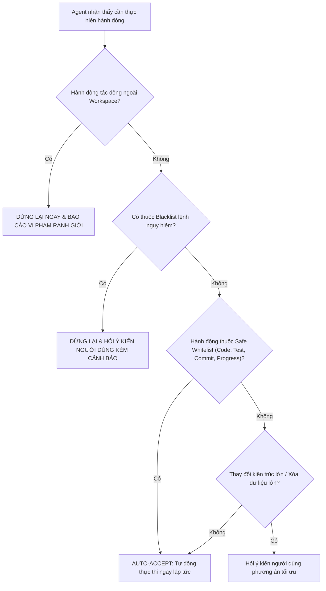

# Safe Auto-Accept & Autonomous Execution Guardrails

Skill này thiết lập cơ chế **tự hành an toàn (Autonomous Execution with Zero Friction)** cho toàn bộ AI Agent trong dự án DoVe.

Khi kích hoạt, Agent **tự động phê duyệt (Auto-Accept)** và tiến hành các tác vụ phát triển thông thường mà không cần dừng lại hiển thị bảng hỏi / popup xin phép vụn vặt, đồng thời thiết lập **vành đai phòng thủ tuyệt đối (Strict Guardrails)** để bảo vệ máy tính và mã nguồn của người dùng.

---

## 🛡️ 1. Ba Ranh Giới Thép (Strict Boundaries)

### 🔴 Ranh Giới 1: Ràng Buộc Workspace Tuyệt Đối (Workspace Containment)
- **Phạm vi cho phép:** Mọi thao tác đọc, tạo file, chỉnh sửa, xóa tạm thời, chạy script và lệnh shell **CHỈ ĐƯỢC PHÉP DIỄN RA TRONG THƯ MỤC DỰ ÁN HIỆN TẠI**:
  ```text
  Workspace Root: d:\Tu-hoc\project\DoVe
  ```
- **Nghiêm cấm tuyệt đối:**
  - Không đọc, không ghi, không sửa bất kỳ file hoặc thư mục nào ngoài thư mục dự án (ví dụ: `C:\Windows`, `C:\Program Files`, thư mục cá nhân `C:\Users\...` ngoài phạm vi bộ nhớ cache công cụ, các ổ đĩa `D:\` ngoài workspace, Desktop, v.v.).
  - Mọi đường dẫn tương đối hoặc tuyệt đối trong các câu lệnh đều phải giải quyết (resolve) về bên trong workspace.

---

### ⛔ Ranh Giới 2: Danh Sách Đen Các Câu Lệnh Nguy Hiểm (Destructive Commands Blacklist)

Khi gặp bất kỳ câu lệnh nào thuộc danh sách dưới đây, **TUYỆT ĐỐI KHÔNG TỰ ĐỘNG THỰC HIỆN**:

| Lĩnh vực | Câu lệnh bị CẤM thực hiện tự động | Lý do an toàn |
|---|---|---|
| **Git** | `git reset --hard` | Mất toàn bộ thay đổi chưa commit không thể phục hồi |
| **Git** | `git push --force` / `git push -f` | Ghi đè lịch sử remote repo, nguy cơ mất commit của người khác |
| **Git** | `git clean -f` / `git clean -fd` / `git clean -fdx` | Xóa sạch các file chưa track trong working directory |
| **Git** | `git branch -D <branch>` | Ép xóa nhánh khi chưa merge |
| **Git** | `git checkout .` / `git restore .` (toàn bộ workspace) | Xóa trắng working tree mà không lưu trữ |
| **Filesystem (Linux/Bash)** | `rm -rf /`, `rm -rf ~`, `rm -rf *`, `rm -rf .*` | Nguy cơ xóa nhầm thư mục gốc hoặc toàn bộ dự án |
| **Filesystem (Windows/PS)** | `Remove-Item -Recurse -Force C:\*`, `del /f /s /q *` | Phá hủy file hệ thống hoặc xóa diện rộng |
| **Hệ điều hành** | `Format-Volume`, `diskpart`, `fdisk`, `mkfs` | Định dạng ổ đĩa |
| **Database** | `DROP DATABASE`, `DROP SCHEMA public CASCADE` | Phá hủy cơ sở dữ liệu |
| **Process/System** | Lệnh can thiệp Registry, thay đổi Firewall, dừng Service hệ điều hành | Gây mất ổn định máy chủ / máy cá nhân |

> ⚠️ **Quy tắc ngoại lệ:** Nếu một tác vụ thực sự đòi hỏi phải dọn dẹp file tạm (ví dụ xóa file log crash cụ thể `apps/api/hs_err_pid*.log` hoặc xóa cache `target/`, `node_modules/.cache`), Agent chỉ được xóa **đích danh đường dẫn cụ thể bên trong workspace**.

---

### 🟢 Ranh Giới 3: Danh Mục Được Phép Auto-Accept (Safe Action Whitelist)

Agent được toàn quyền **tự động quyết định và thực thi liên tục** các hành động sau mà không cần hỏi người dùng:

1. **Vòng lặp TDD:**
   - Viết Unit / Integration Test (Red phase).
   - Viết mã nguồn nghiệp vụ để pass test (Green phase).
   - Tối ưu và refactor mã nguồn (Refactor phase).
2. **Kiểm tra và Format chuẩn:**
   - Chạy lệnh biên dịch: `./mvnw test-compile`, `npm run typecheck`.
   - Chạy unit tests: `./mvnw test -Dtest=...`, `npm run test`.
   - Định dạng code tự động: `./mvnw spotless:apply`, `npm run lint -- --fix`.
3. **Quản lý Git cục bộ theo kế hoạch:**
   - `git add <file cụ thể>` (chỉ add file liên quan đến task, không add bừa bãi).
   - `git commit` độc lập theo chuẩn Conventional Commits 1.0 (`feat:`, `test:`, `refactor:`, `docs:`, `fix:`).
   - Kiểm tra `git status`, `git diff`, `git log`.
4. **Cập nhật tài liệu tiến độ:**
   - Tự động đánh dấu `[x]` và ghi commit hash vào `docs/progress/PROGRESS-XX.md`.
   - Cập nhật số lượng task hoàn thành vào `docs/progress/PROGRESS-00-overview.md`.
5. **Tiếp nối task trong Plan:**
   - Sau khi hoàn thành Task N (test xanh, format chuẩn, commit xong, tick progress), tự động chuyển sang Task N+1 theo đúng lộ trình `docs/plans/PLAN-XX.md`.

---

## 📋 2. Ma Trận Quyết Định (Decision Matrix)



---

## ⚙️ 3. Hướng Dẫn Thực Hành Cho Agent (Agent Directives)

### Quy Tắc 1: Không Hỏi Các Câu Hỏi Hiển Nhiên
- Khi task trong plan đã ghi rõ: "Viết test", "Thực thi tính năng", "Commit với format X", "Cập nhật progress" → **Không được hỏi:** *"Bạn có muốn tôi commit không?"* hay *"Tôi có nên chuyển sang task tiếp theo không?"*.
- **Hành động đúng:** Tự động thực thi từng bước, hiển thị báo cáo ngắn gọn sau khi hoàn thành.

### Quy Tắc 2: Kiểm Tra Workspace Trước Khi Chạy Lệnh Shell
- Luôn đảm bảo thư mục làm việc hiện tại (`cwd`) là thư mục dự án hoặc thư mục con hợp lệ (`apps/api`, `apps/mobile`).
- Nếu script cần đường dẫn tuyệt đối, kiểm tra tiền tố bắt buộc phải bắt đầu bằng `d:\Tu-hoc\project\DoVe`.

### Quy Tắc 3: Xử Lý Khi Có Trục Trặc (Self-Correction First)
- Khi gặp lỗi biên dịch, lỗi test, lỗi format hoặc lỗi bộ nhớ tạm thời:
  1. Tự động phân tích nguyên nhân gốc rễ.
  2. Tự động áp dụng biện pháp sửa lỗi tối giản (Ponytail).
  3. Chạy lại test xác minh.
  4. Chỉ dừng lại hỏi khi đã thử nghiệm các phương án hợp lý mà vẫn bị chặn kỹ thuật (Blocked).

---

## 📌 4. Ví Dụ Cụ Thể (Concrete Scenarios)

### ✅ Kịch Bản Tự Hành (Auto-Accepted):
> **Tình huống:** Hoàn thành xong Task T05.02 (Viết DTO và test controller).  
> **Hành vi Agent:** Tự động chạy `./mvnw spotless:apply` → `git add ...` → `git commit -m "feat(api): ..."` → Cập nhật `PROGRESS-05-rest-api.md` → Tự động bắt đầu đọc đề bài T05.03 và làm tiếp.

### ⛔ Kịch Bản Bị Chặn (Blocked by Guardrail):
> **Tình huống:** Agent muốn dọn dẹp các nhánh thừa hoặc reset working tree.  
> **Ý định:** Muốn chạy `git reset --hard HEAD~1` hoặc `git clean -fd`.  
> **Hành vi Agent:** **DỪNG LẠI**. Báo cáo rõ ràng: *"Phát hiện lệnh có nguy cơ mất mát dữ liệu `git reset --hard`. Theo skill safe-auto-accept, lệnh này cần người dùng xác nhận trực tiếp trước khi chạy."*
