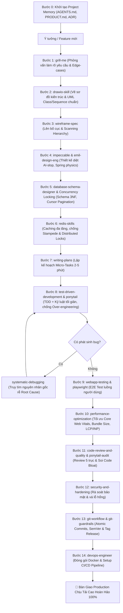

# 🛠️ Cẩm Nang Agent Skills: Vibecoding Kỷ Luật Thép, Anti-AI-Slop UX/UI, Sơ Đồ UML Draw.io, Tối Giản Mã Nguồn (Ponytail), Database 3NF, High-Performance & Concurrency (Full Production)

Tài liệu tổng hợp các **Agent Skills** chuẩn mực nhất từ hệ sinh thái [skills.sh](https://skills.sh/). Được thiết kế để biến AI Coding Assistant (Antigravity, Claude Code, Cursor, Windsurf...) từ một công cụ "vibe bừa bãi" thành một **Senior Principal Engineer & Performance Architect kỷ luật thép**: có quy trình trọn vẹn từ **Quản trị Bộ Nhớ Dự Án -> Làm rõ Spec -> Thiết kế Sơ Đồ Kiến Trúc & UML Chuẩn Draw.io -> Wireframe -> Thiết kế Diệt AI-Slop (Impeccable & Emil Craft) -> Database 3NF (MySQL/Postgres) -> Tối Ưu Hiệu Năng & Chịu Tải Hàng Nghìn Người (Redis Caching, Concurrency Locking, Cursor Pagination) -> Lập plan -> TDD -> Tối Giản Mã Nguồn & Chống Over-engineering (Ponytail) -> Debug -> E2E Test -> Tối Ưu Tốc Độ Web (Core Web Vitals) -> Code Review Gate -> Audit Bảo Mật -> Git Atomic Commit & Tag Release -> Docker/CI-CD Deployment**.

Bạn có thể lưu file này và copy qua bất kỳ dự án nào để sử dụng.

---

## 🚀 1. Hướng Dẫn Cài Đặt Nhanh (1-Click Install)

### Cách A: Cài đặt Toàn Cục (Global - Khuyên dùng)
> *Cài một lần, dùng được mãi mãi cho mọi dự án và thư mục trên máy tính của bạn.*

```bash
# ==========================================================
# 0. META-SKILL: Tìm kiếm & tra cứu kho 100k+ skills
# ==========================================================
npx skills add vercel-labs/skills@find-skills -g -y

# ==========================================================
# 1. BỘ VIBECODING KỶ LUẬT THÉP (Plan, TDD, Testing, Debug)
# ==========================================================
# Trọn bộ Superpowers của Jesse Vincent (obra):
npx skills add obra/superpowers -g -y

# Bộ phỏng vấn làm rõ yêu cầu & TDD của Matt Pocock:
npx skills add mattpocock/skills@grill-me -g -y
npx skills add mattpocock/skills@tdd -g -y
npx skills add mattpocock/skills@to-tickets -g -y

# Kiểm thử Web & E2E Playwright:
npx skills add anthropics/skills@webapp-testing -g -y
npx skills add currents-dev/playwright-best-practices-skill@playwright-best-practices -g -y

# ==========================================================
# 2. BỘ WIREFRAME, UI/UX & DIỆT AI-SLOP (Anti-AI-Slop & Craft)
# ==========================================================
# Trọn bộ Impeccable của Paul Bakaus (Diệt AI-slop, Design Director cho AI):
npx skills add pbakaus/impeccable -g -y

# Chuẩn thiết kế Web Interface từ Vercel Engineering:
npx skills add vercel-labs/agent-skills@web-design-guidelines -g -y

# Micro-interactions & Animation chuẩn Linear/Apple của Emil Kowalski:
npx skills add emilkowalski/skills@emil-design-eng -g -y

# Tư duy Frontend Designer đỉnh cao từ Anthropic:
npx skills add anthropics/skills@frontend-design -g -y

# Bố cục Wireframe & Hệ thống UI 50+ styles:
npx skills add Owl-Listener/designer-skills@wireframe-spec -g -y
npx skills add nextlevelbuilder/ui-ux-pro-max-skill@ui-ux-pro-max -g -y

# ==========================================================
# 2.1 BỘ SƠ ĐỒ HỆ THỐNG, DRAW.IO & VẼ UML CHUẨN QUỐC TẾ
# ==========================================================
# Bộ vẽ Draw.io & UML toàn diện nhất (Class, Sequence, ERD, C4 - agents365):
npx skills add agents365-ai/drawio-skill@drawio-skill -g -y

# Bộ vẽ kiến trúc YAML-first & xuất ảnh 300dpi/SVG (Top 1 Draw.io 8.3K installs):
npx skills add bahayonghang/drawio-skills@drawio -g -y

# Bộ công cụ Draw.io MCP chính chủ từ cha đẻ JGraph:
npx skills add jgraph/drawio-mcp@drawio -g -y

# ==========================================================
# 3. BỘ DATABASE ECOMMERCE PRODUCTION (Postgres & MySQL)
# ==========================================================
# Chuẩn hóa & Audit Schema 3NF chung cho mọi loại Database:
npx skills add softaworks/agent-toolkit@database-schema-designer -g -y

# Nếu dùng PostgreSQL (Chuẩn Supabase, RLS, GIN index, Concurrency Locking):
npx skills add supabase/agent-skills@supabase-postgres-best-practices -g -y

# Nếu dùng MySQL / MariaDB (Chuẩn PlanetScale, InnoDB, Clustered index, Deadlocks):
npx skills add planetscale/database-skills@mysql -g -y

# ==========================================================
# 4. BỘ TỐI ƯU HIỆU NĂNG, TỐC ĐỘ WEB & CHỊU TẢI (High Performance & Concurrency)
# ==========================================================
# Tối ưu tốc độ tải trang, Core Web Vitals & Bundle (Addy Osmani - Google Chrome):
npx skills add addyosmani/agent-skills@performance-optimization -g -y

# Caching đa tầng, chống nghẽn Concurrency & Redis (từ Redis Official):
npx skills add redis/redis-skills -g -y

# ==========================================================
# 5. BỘ TỐI GIẢN MÃ NGUỒN & CODE REVIEW (Anti-Code-Bloat Gate)
# ==========================================================
# Tối giản mã nguồn, diệt Code Bloat & Over-engineering (Dietrich Gebert):
npx skills add https://github.com/dietrichgebert/ponytail --skill ponytail -g -y

# Rà soát code đa trục (Đúng đắn, Readability, Clean Architecture, Performance - Addy Osmani):
npx skills add addyosmani/agent-skills@code-review-and-quality -g -y

# Code review độc lập theo Specs & Standards (Matt Pocock):
npx skills add mattpocock/skills@code-review -g -y

# ==========================================================
# 6. BỘ SHIP-TO-PRODUCTION (Bảo mật, Git Guardrails & DevOps)
# ==========================================================
# Rà soát bảo mật & vá lỗ hổng (từ Addy Osmani - Google Chrome):
npx skills add addyosmani/agent-skills@security-and-hardening -g -y

# Git Workflow, SemVer Versioning & Đánh Tag Release (từ Addy Osmani):
npx skills add addyosmani/agent-skills@git-workflow-and-versioning -g -y

# Git Guardrails & Atomic Commits (từ Matt Pocock):
npx skills add mattpocock/skills@git-guardrails-claude-code -g -y

# DevOps, Docker & CI/CD Pipeline:
npx skills add jeffallan/claude-skills@devops-engineer -g -y
```

### Cách B: Cài đặt Riêng cho Từng Dự Án (Project Workspace)
> *Chỉ chạy trong thư mục gốc của dự án (tạo thư mục `.agents/skills` và file `skills-lock.json` để chia sẻ cho cả team qua git).*

```bash
# Chạy trong thư mục gốc dự án:
npx skills add vercel-labs/skills@find-skills -y
npx skills add obra/superpowers -y
npx skills add mattpocock/skills@grill-me -y
npx skills add mattpocock/skills@tdd -y
npx skills add currents-dev/playwright-best-practices-skill@playwright-best-practices -y
npx skills add pbakaus/impeccable -y
npx skills add vercel-labs/agent-skills@web-design-guidelines -y
npx skills add emilkowalski/skills@emil-design-eng -y
npx skills add anthropics/skills@frontend-design -y
npx skills add Owl-Listener/designer-skills@wireframe-spec -y
npx skills add nextlevelbuilder/ui-ux-pro-max-skill@ui-ux-pro-max -y
npx skills add agents365-ai/drawio-skill@drawio-skill -y
npx skills add bahayonghang/drawio-skills@drawio -y
npx skills add jgraph/drawio-mcp@drawio -y
npx skills add softaworks/agent-toolkit@database-schema-designer -y
npx skills add supabase/agent-skills@supabase-postgres-best-practices -y
npx skills add planetscale/database-skills@mysql -y
npx skills add addyosmani/agent-skills@performance-optimization -y
npx skills add redis/redis-skills -y
npx skills add https://github.com/dietrichgebert/ponytail --skill ponytail -y
npx skills add addyosmani/agent-skills@code-review-and-quality -y
npx skills add mattpocock/skills@code-review -y
npx skills add addyosmani/agent-skills@security-and-hardening -y
npx skills add addyosmani/agent-skills@git-workflow-and-versioning -y
npx skills add mattpocock/skills@git-guardrails-claude-code -y
npx skills add jeffallan/claude-skills@devops-engineer -y
```

### Các lệnh quản lý tiện ích:
- **Tìm kiếm skill bất kỳ qua CLI:** `npx skills find <từ-khóa>`
- **Cập nhật tất cả skill lên bản mới nhất:** `npx skills update`
- **Xem danh sách skill đã cài:** `npx skills list`
- **Gỡ bỏ một skill:** `npx skills remove <tên-skill>`

---

## 🧠 2. Thiết Lập Bộ Nhớ Dự Án (Project Memory Blueprint)

> *Vấn đề lớn nhất của Vibecoding khi dự án phình to là **"Context Amnesia" (AI mất trí nhớ)**: Sau 10–20 lượt chat, AI sẽ quên tech stack, quên các quy ước đã thỏa thuận, hoặc tự ý xóa/đổi cấu trúc thư mục.*

Một dự án Vibecode chuyên nghiệp bắt buộc phải có **4 tầng bộ nhớ dạng file Markdown** đặt ngay trong source code:

| Tầng bộ nhớ | File định danh | Vai trò & Nội dung |
|---|---|---|
| **1. System Blueprint** | `AGENTS.md` (hoặc `CLAUDE.md` / `GEMINI.md`) | **Luật bất thành văn của dự án:** Tech stack chuẩn, lệnh chạy server, lệnh chạy test, convention đặt tên file, quy tắc cấm (ví dụ: không dùng `any` trong TypeScript, không dùng inline CSS). |
| **2. Design & Product Memory** | `PRODUCT.md` & `DESIGN.md` | **Do skill `impeccable` tự tạo và duy trì:** Ghi nhớ giá trị cốt lõi sản phẩm, persona khách hàng, bảng mã màu tokens, typography, khoảng cách spacing. Giúp AI giữa buổi sáng và buổi chiều luôn tạo ra UI đồng nhất. |
| **3. Architecture Decision Records** | `docs/adr/001-xxx.md` | **Bộ nhớ kiến trúc:** Ghi lại lý do tại sao chọn giải pháp kỹ thuật (VD: *Tại sao chọn MySQL thay vì Postgres? Tại sao chọn Zustand thay vì Redux?*). Ngăn AI "nổi hứng" đề xuất đập đi viết lại framework. |
| **4. Task State Memory** | `SCRATCHPAD.md` / `PROGRESS.md` | **Bộ nhớ tiến độ:** Ghi nhận task vừa hoàn thành, task đang làm dở, và danh sách blockers. Khi bắt đầu phiên chat mới, chỉ cần bảo AI đọc file này là tiếp tục mạch công việc ngay lập tức. |

---

## 🔍 3. Meta-Skill: Trợ Lý Tìm Kiếm & Khám Phá Skills

### ⚡ Skill: `find-skills` (từ Vercel Labs)
- **Nguồn:** `vercel-labs/skills@find-skills`
- **Link:** [skills.sh](https://skills.sh/)
- **Công dụng:** Skill "mẹ" giúp AI tự động tra cứu hơn 100.000+ skills từ kho mã nguồn mở [skills.sh](https://skills.sh/). AI sẽ tự động kích hoạt khi bạn hỏi: *"Có skill nào làm X không?", "Tìm skill cho Next.js/Docker/Golang"*.

---

## 🛡️ 4. Bộ Skill Vibecoding Kỷ Luật Thép (Planning, TDD & Verification)

Biến việc gõ code cùng AI thành một quy trình sản xuất phần mềm tiêu chuẩn cao:

### 1️⃣ Khảo sát & Phỏng vấn ngược: `mattpocock/skills@grill-me`
- **Lượt cài:** **~1.3M installs**
- **Công dụng:** Ngăn chặn lỗi "hiểu lầm ý người dùng". AI sẽ đóng vai trò Tech Lead phỏng vấn ngược lại bạn, bắt bạn làm rõ mọi edge-case, ràng buộc kỹ thuật trước khi gõ 1 dòng code.
- **Prompt mẫu:**
  > *"Mình muốn xây dựng tính năng giỏ hàng checkout có mã giảm giá. Hãy dùng skill `grill-me` chất vấn và phỏng vấn mình về các edge-case và tech stack trước khi làm."*

### 2️⃣ Lập kế hoạch chi tiết: `obra/superpowers@writing-plans`
- **Lượt cài:** **~271.5K installs**
- **Công dụng:** Chia task lớn thành các micro-task siêu nhỏ (2-5 phút thực thi), có tiêu chí nghiệm thu rõ ràng, chỉ định cụ thể file nào cần tạo, hàm nào cần sửa.
- **Prompt mẫu:**
  > *"Dùng skill `writing-plans` lập kế hoạch chi tiết từng bước. Mỗi bước phải nêu rõ: file cần sửa, test cần viết trước và tiêu chí PASS."*

### 3️⃣ Kỷ luật TDD (Test-First): `obra/superpowers@test-driven-development` & `mattpocock/skills@tdd`
- **Lượt cài:** **~247.5K installs** & **~1.1M installs**
- **Công dụng:** **Kỷ luật bất di bất dịch: KHÔNG ĐƯỢC VIẾT CODE SẢN PHẨM KHI CHƯA CÓ TEST BỊ FAIL (RED PHASE).** Nếu AI lỡ tay viết code trước, skill này ép AI xóa đi và viết lại từ bài test.
- **Prompt mẫu:**
  > *"Bắt đầu thực hiện Plan theo đúng quy chuẩn `test-driven-development`: Viết Unit Test trước (Red phase) -> Chạy test xác nhận FAIL -> Viết code tối giản vừa đủ để test PASS (Green phase) -> Refactor sạch sẽ."*

### 4️⃣ Thực thi tuần tự: `obra/superpowers@executing-plans`
- **Lượt cài:** **~232.1K installs**
- **Công dụng:** Giữ cho AI đi đúng hướng, làm xong task nào đánh dấu và test task đó, tuyệt đối không nhảy cóc hay sửa lan man ra ngoài phạm vi.
- **Prompt mẫu:**
  > *"Dùng skill `executing-plans` thực hiện Task 1 và Task 2. Chạy test xác nhận trước khi chuyển sang bước tiếp theo."*

### 5️⃣ Kiểm thử Web App & E2E: `anthropics/skills@webapp-testing` & `playwright-best-practices`
- **Lượt cài:** **~176.2K installs** & **~93K installs**
- **Công dụng:** Hướng dẫn AI viết test luồng người dùng (Integration / E2E) bằng Playwright hoặc Vitest, kiểm tra các thao tác click, điền form, responsive và console error.
- **Prompt mẫu:**
  > *"Dùng skill `playwright-best-practices` viết bộ E2E test cho luồng: User chọn sản phẩm -> Thêm vào giỏ -> Nhập mã coupon -> Bấm checkout."*

### 6️⃣ Bắt bệnh khoa học: `obra/superpowers@systematic-debugging`
- **Lượt cài:** **~289.7K installs**
- **Công dụng:** Khi test fail hoặc bug xuất hiện, cấm AI đoán mò hoặc thử sửa lung tung. Skill bắt AI thực hiện Root-Cause Analysis: đưa ra giả thuyết, chèn trace log xác nhận rồi mới sửa đúng 1 chỗ.
- **Prompt mẫu:**
  > *"Test đang fail ở bước tính tiền ship. Hãy dùng `systematic-debugging` tìm ra nguyên nhân gốc rễ (Root Cause) trước khi sửa code."*

### 7️⃣ Nghiệm thu trước khi bàn giao: `obra/superpowers@verification-before-completion`
- **Lượt cài:** **~236.5K installs**
- **Công dụng:** Cấm AI tự ý nói "Em đã làm xong" khi chưa chạy lại toàn bộ test suite, kiểm tra linter/typecheck và kiểm tra không có hồi quy (no regression).
- **Prompt mẫu:**
  > *"Dùng `verification-before-completion` rà soát toàn bộ dự án: chạy toàn bộ test suite, type-check và xác nhận hệ thống hoàn toàn sẵn sàng."*

---

## 🎨 5. Nhóm Skill UX/UI Design & Diệt AI-Slop (Anti-AI-Slop & Craftsmanship)

Khắc phục hoàn toàn hiện tượng **"AI-slop"** (giao diện trông rập khuôn, màu tím gradient sến rện, bo góc vô hồn, chữ xám mờ nhạt nhòa, thẻ card thừa thãi):

### 💎 Skill 1: `pbakaus/impeccable` (Của Paul Bakaus)
- **Nguồn:** `pbakaus/impeccable`
- **Lượt cài:** **~328.9K installs** | Bộ công cụ gồm: `impeccable`, `polish`, `audit`, `critique`, `distill`, `animate`
- **Link chi tiết:** [skills.sh/pbakaus/impeccable/impeccable](https://skills.sh/pbakaus/impeccable/impeccable)
- **Công dụng chính:**
  - Đóng vai trò như một **Design Director khó tính** đứng sau AI.
  - **Diệt trừ AI-slop:** Cấm các anti-patterns điển hình của AI (gradient tím-hồng không lý do, glassmorphism bừa bãi, card lồng card, chữ xám tương phản kém).
  - Tự động tạo và cập nhật file `DESIGN.md` và `PRODUCT.md` để ghi nhớ triết lý thiết kế và design tokens của dự án xuyên suốt các phiên làm việc.
  - Cung cấp các lệnh: `/impeccable audit` (soi lỗi UI), `/impeccable polish` (đánh bóng chi tiết), `/impeccable distill` (tối giản hóa các chi tiết thừa thãi).
- **Prompt mẫu:**
  > *"Dùng `impeccable:critique` và `impeccable:polish` soi lại toàn bộ giao diện trang này: loại bỏ các chi tiết thừa (AI-slop), cân chỉnh lại typographic contrast và khoảng cách spacing cho thật sắc nét."*

---

### 🖤 Skill 2: `web-design-guidelines` (từ Vercel Engineering)
- **Nguồn:** `vercel-labs/agent-skills@web-design-guidelines`
- **Lượt cài:** **~728K installs**
- **Link chi tiết:** [skills.sh/vercel-labs/agent-skills/web-design-guidelines](https://skills.sh/vercel-labs/agent-skills/web-design-guidelines)
- **Công dụng chính:**
  - Quy chuẩn thiết kế Web Interface hiện đại, tối giản và sang trọng theo trường phái **Vercel / Next.js / Geist Design**.
  - Quy định tỉ lệ font chữ chuẩn, optical alignment, spacing hệ 4px/8px, độ tương phản chuẩn WCAG 2.1 AAA.
- **Prompt mẫu:**
  > *"Áp dụng `web-design-guidelines` để xây dựng trang Landing page này: phong cách tối giản, hiện đại, dark mode sâu thẳm, typography rõ ràng và không dùng các hiệu ứng lòe loẹt."*

---

### ✨ Skill 3: `emil-design-eng` (từ Emil Kowalski - Tác giả Sonner, Vaul)
- **Nguồn:** `emilkowalski/skills@emil-design-eng`
- **Lượt cài:** **~347.5K installs**
- **Link chi tiết:** [skills.sh/emilkowalski/skills/emil-design-eng](https://skills.sh/emilkowalski/skills/emil-design-eng)
- **Công dụng chính:**
  - Chuyên sâu về **Micro-interactions, Haptic feedback & Animation vật lý (Spring Physics)** ở đẳng cấp Linear / Apple.
  - Chấm dứt tình trạng AI code animation bị giật cục, transition cứng nhắc; thay bằng hiệu ứng mượt như bơ (fluid layout animations, gesture drag, toast notifications).
- **Prompt mẫu:**
  > *"Dùng skill `emil-design-eng` để tinh chỉnh tương tác cho Cart Drawer và Modal checkout: thêm spring physics, chuyển động đóng mở mượt mà và cảm giác bấm xúc giác cao cấp."*

---

### 🎨 Skill 4: `frontend-design` (từ Anthropic Official)
- **Nguồn:** `anthropics/skills@frontend-design`
- **Lượt cài:** **~980.8K installs**
- **Link chi tiết:** [skills.sh/anthropics/skills/frontend-design](https://skills.sh/anthropics/skills/frontend-design)
- **Công dụng chính:**
  - Huấn luyện AI có tư duy của Senior Frontend Designer thực thụ: cách lựa chọn font ghép đôi độc đáo, bảng màu có cảm xúc, bố cục phá cách thay vì xếp các khối hộp Bootstrap/Tailwind mặc định.
- **Prompt mẫu:**
  > *"Dùng `frontend-design` thiết kế một layout độc bản cho trang danh mục sản phẩm, tránh các bố cục generic thông thường của AI."*

---

### 📐 Skill 5 & 6: `wireframe-spec` & `ui-ux-pro-max`
- **`wireframe-spec` (Owl-Listener):** Định hình phân cấp nội dung (**Content Hierarchy & Scanning Order**), xác định khối layout và interaction notes trước khi code.
- **`ui-ux-pro-max` (NextLevelBuilder - 393K+ installs):** Kho tài nguyên 50+ design styles, 192 bảng màu sản phẩm, 119 UX guidelines để sinh component hoàn chỉnh.

---

## 📊 6. Nhóm Skill Sơ Đồ Kiến Trúc & Vẽ UML Chuẩn Draw.io (Class, Sequence & C4 Model)

> *Thiết kế sơ đồ kiến trúc hệ thống và vẽ toàn bộ các loại sơ đồ UML (Class, Sequence, State, ERD, C4) chuẩn mực quốc tế, xuất trực tiếp thành file `.drawio` (XML mxGraph) để kéo thả, chỉnh sửa hoặc biên dịch ra ảnh vector SVG/PNG sắc nét.*

### 🥇 Skill 1: `drawio-skill` (từ Agents365-ai - Toàn diện nhất cho UML 2.x & Code-to-Diagram)
- **Nguồn:** `agents365-ai/drawio-skill@drawio-skill`
- **Lượt cài:** **~5.4K installs**
- **Link chi tiết:** [skills.sh/agents365-ai/drawio-skill/drawio-skill](https://skills.sh/agents365-ai/drawio-skill/drawio-skill)
- **Công dụng chính:**
  - **Sinh trực tiếp file `.drawio` native (XML mxGraph):** Mở và chỉnh sửa 100% trên app Draw.io Desktop hoặc web [app.diagrams.net](https://app.diagrams.net), hoặc mở qua extension Draw.io trên VS Code / Cursor / Antigravity.
  - **Tuân thủ nghiêm ngặt chuẩn UML 2.x:**
    - **Class Diagram:** Phân chia chuẩn 3 ngăn (Tên lớp, Thuộc tính, Phương thức) kèm ký hiệu visibility (`+` public, `-` private, `#` protected, `~` package). Ký hiệu chuẩn xác các loại quan hệ: Kế thừa/Generalization (`──▷`), Thực thi/Realization (`··▷`), Composition kết hợp chặt (`──◆`), Aggregation tập hợp lỏng (`──◇`), Dependency phụ thuộc (`··>`), Association liên kết (`──>`).
    - **Sequence Diagram:** Lifelines (đường đời), Activation boxes (thanh kích hoạt thực thi), Thông điệp đồng bộ Sync call (`──▶`), Bất đồng bộ Async call (`──▷`), Return message (`- - ▶`), và các frame điều kiện chuẩn (`alt`, `opt`, `loop`, `par`).
    - **Use Case, Activity Diagram & State Machine:** Đầy đủ Actor, System boundary, Decision diamond, Swimlanes phân luồng và State transitions.
  - **Layout Engine thông minh (Chống rối dây):** Tự động tính toán tọa độ x/y, chống hiện tượng đường nối đè chéo (edge crossing) hay cắt ngang qua chữ.
  - **Reverse Engineering (Đảo ngược từ code sang sơ đồ):** Quét source code dự án, OpenAPI spec, SQL schema hoặc Terraform để tự động sinh ra sơ đồ kiến trúc và Class Diagram tương ứng.
- **Prompt mẫu:**
  > *"Dùng skill `drawio-skill` vẽ Class Diagram chuẩn UML 2.5 cho module Giỏ hàng và Thanh toán: lưu thành file `checkout_class.drawio`. Đảm bảo đủ 3 ngăn attributes/methods kèm visibility (+, -, #), thể hiện đúng Composition giữa Order và OrderItem, quan hệ Generalization cho PaymentMethod (CreditCard, Momo, VNPay). Cân chỉnh layout không bị đè chéo."*
  > *"Dùng skill `drawio-skill` sinh Sequence Diagram luồng Xác thực OAuth2/JWT lưu vào file `auth_sequence.drawio`: đủ Lifelines cho User, Web App, API Gateway, AuthService, Database; vẽ activation boxes và khung alt kiểm tra token hợp lệ hay hết hạn."*

---

### 🥈 Skill 2: `drawio` (từ bahayonghang - Top 1 Draw.io ~8.3K installs)
- **Nguồn:** `bahayonghang/drawio-skills@drawio`
- **Lượt cài:** **~8.3K installs**
- **Link chi tiết:** [skills.sh/bahayonghang/drawio-skills/drawio](https://skills.sh/bahayonghang/drawio-skills/drawio)
- **Công dụng chính:**
  - **Quy trình Offline YAML-First:** Lên bản vẽ kiến trúc bằng YAML có schema nghiêm ngặt, sau đó tự động biên dịch ra file `.drawio` và render ra file ảnh PNG chất lượng cao **300dpi** hoặc SVG vector.
  - **Bộ Theme & Palette màu chống AI-Slop:** Cung cấp sẵn các bộ màu trang nhã (Corporate, Modern Dark, Clean Minimal, Colorblind-safe) giúp sơ đồ nhìn chuyên nghiệp như trong tài liệu của AWS / Stripe / Google.
  - **Kiến trúc Cloud & C4 Model:** Thiết kế sơ đồ hạ tầng đám mây (AWS, GCP, Azure), Network Topologies, C4 Container & Component Diagrams.
- **Prompt mẫu:**
  > *"Dùng skill `bahayonghang/drawio-skills` thiết kế sơ đồ kiến trúc hệ thống Microservices Ecommerce gồm: API Gateway, Auth Service, Product Service, Order Service, RabbitMQ và Postgres. Áp dụng Corporate theme và xuất ra file `architecture.drawio` kèm ảnh SVG vector."*

---

### 🥉 Skill 3: `drawio` (từ JGraph - Cha đẻ chính thức của Draw.io)
- **Nguồn:** `jgraph/drawio-mcp@drawio`
- **Lượt cài:** **~3.1K installs**
- **Công dụng chính:**
  - Kho tài liệu chuẩn và Model Context Protocol (MCP) server do chính **JGraph** (công ty tạo ra Draw.io và mxGraph) phát triển.
  - Cung cấp toàn bộ schema XML gốc (`xml-reference.md`), bảng tra cứu shape/icon và layout engine chính thức.

---

### 💡 Bí kíp thực chiến: Chuẩn UML tuyệt đối 100% bằng Native PlantUML/Mermaid trong Draw.io
Khi cần vẽ những sơ đồ UML đồ sộ (hàng chục class hay sequence phức tạp), việc xếp tọa độ x/y thủ công đôi khi mất thời gian. Draw.io có sẵn tính năng cực mạnh:
1. Bạn yêu cầu AI viết script **PlantUML** hoặc **Mermaid** theo chuẩn UML 2.5 khắt khe.
2. Mở Draw.io (trên web [app.diagrams.net](https://app.diagrams.net) hoặc trong IDE), bấm menu: **Arrange (Sắp xếp) ➔ Insert (Chèn) ➔ Advanced (Nâng cao) ➔ PlantUML / Mermaid**.
3. Paste đoạn code vào ➔ Draw.io sẽ **tự động vẽ thành các khối shape vector chuẩn xác từng milimet**, cho phép bạn tự do kéo thả, đổi màu hay xuất ra file `.drawio` bất kỳ lúc nào.

---

## 🗄️ 7. Nhóm Skill Database Ecommerce Production (PostgreSQL & MySQL)

### 🥇 Skill 1: `database-schema-designer` (Kiến trúc & Chuẩn hóa 3NF chung)
- **Nguồn:** `softaworks/agent-toolkit@database-schema-designer`
- **Công dụng:**
  - Thiết kế Data Model chuẩn hóa **3NF** cho E-commerce (Users, Products, Variants, Inventory, Orders, Order Items, Payments, Shipments).
  - **Audit / Đánh giá Schema hiện tại (`review schema`):** Soi vi phạm chuẩn hóa, bắt lỗi kiểu dữ liệu (tránh `FLOAT` cho tiền tệ, tránh `VARCHAR(255)` dư thừa), kiểm tra thiếu Foreign Key, thiếu `CHECK constraints`.
  - Tối ưu hóa **Indexing Strategy** (`add indexes`): Composite index, Foreign Key indexes, giảm thiểu Full Table Scan.
  - Tự động sinh file **Migration 2 chiều (`UP` và `DOWN`)** an toàn không gây downtime.
- **Prompt mẫu:**
  > *"Hãy dùng `database-schema-designer` review schema database hiện tại của mình ở file `schema.prisma` (hoặc đoạn SQL này): chỉ ra các lỗi thiết kế, rủi ro toàn vẹn dữ liệu và đề xuất cách sửa."*

---

### 🥈 Skill 2: `supabase-postgres-best-practices` (Dành riêng cho PostgreSQL)
- **Nguồn:** `supabase/agent-skills@supabase-postgres-best-practices`
- **Lượt cài:** **~442.1K installs** | Nguồn chính thức Supabase
- **Công dụng:**
  - Chuyên sâu tối ưu hóa **PostgreSQL Enterprise**: Row-Level Security (RLS) bảo mật dữ liệu theo Tenant/User.
  - Kiểm soát **ACID Transactions** & Concurrency Locking: Chống lỗi bán quá số lượng tồn kho (Overselling / Race condition) khi Flash Sale bằng `SELECT ... FOR UPDATE` và Advisory Locks.
  - Table Partitioning theo thời gian (chia bảng `orders`, `audit_logs` theo tháng/năm khi dữ liệu lên tới hàng triệu dòng).
  - Chiến lược Index nâng cao: B-Tree, GIN index cho tìm kiếm Full-text search sản phẩm.
- **Prompt mẫu:**
  > *"Thiết kế hàm PostgreSQL Function / Transaction xử lý đặt hàng có trừ tồn kho sản phẩm, dùng FOR UPDATE khóa dòng, đảm bảo không bị race condition khi 1000 người mua cùng lúc."*

---

### 🥉 Skill 3: `mysql` (Dành riêng cho MySQL & MariaDB - từ PlanetScale)
- **Nguồn:** `planetscale/database-skills@mysql`
- **Lượt cài:** **~8.3K installs** | Nguồn chính thức từ PlanetScale (nhà sáng tạo Vitess)
- **Link chi tiết:** [skills.sh/planetscale/database-skills/mysql](https://skills.sh/planetscale/database-skills/mysql)
- **Công dụng chính:**
  - Chuyên sâu tối ưu hóa **MySQL & Storage Engine InnoDB**.
  - Tránh lỗi phân mảnh ổ cứng và suy giảm hiệu năng kinh điển của MySQL: cấm dùng UUID ngẫu nhiên làm Clustered Primary Key (thay bằng `BIGINT UNSIGNED AUTO_INCREMENT` hoặc UUIDv7 tuần tự).
  - Tối ưu truy vấn bằng `EXPLAIN` và `EXPLAIN ANALYZE`, xử lý triệt để hiện tượng khóa dòng (Row-level Locking / Deadlock) khi hàng nghìn người cùng mua hàng và update tồn kho.
  - Quy chuẩn migration an toàn trên production không làm khóa bảng (Online DDL / Zero-downtime schema changes).
- **Prompt mẫu:**
  > *"Hãy dùng skill `planetscale/database-skills@mysql` tối ưu bảng orders và câu query này trên MySQL: phân tích bằng `EXPLAIN`, kiểm tra Clustered Index và giải quyết nguy cơ deadlock khi update tồn kho."*

---

## ⚡ 8. Nhóm Skill Tối Ưu Hiệu Năng Cao & Chịu Tải Hàng Nghìn Người (High Performance & Concurrency)

> *Bảo đảm hệ thống phản hồi cực nhanh dưới 50ms, tải trang đạt 100/100 Lighthouse và chịu tải hàng chục ngàn người truy cập đồng thời mà không bị sập hay nghẽn cổ chai.*

### 🚀 Skill 1: `performance-optimization` (từ Addy Osmani - Google Chrome)
- **Nguồn:** `addyosmani/agent-skills@performance-optimization`
- **Lượt cài:** **~35K+ installs**
- **Link chi tiết:** [skills.sh/addyosmani/agent-skills/performance-optimization](https://skills.sh/addyosmani/agent-skills/performance-optimization)
- **Công dụng chính:**
  - **Tối ưu Core Web Vitals chuẩn Google Chrome:**
    - **LCP (Largest Contentful Paint < 1.2s):** Tăng tốc render khối nội dung chính đầu trang.
    - **INP (Interaction to Next Paint < 200ms):** Tối ưu luồng phản hồi tức thì khi người dùng click/gõ phím.
    - **CLS (Cumulative Layout Shift = 0):** Triệt tiêu hiện tượng giật giật vỡ layout khi đang tải trang.
  - **Tối ưu Bundle Size & Critical Rendering Path:** Áp dụng Code-Splitting, Dynamic Imports (`lazy`), Tree-shaking loại bỏ thư viện thừa.
  - **Tối ưu Tài nguyên Mạng:** Chuyển đổi định dạng ảnh sang WebP/AVIF tự động, lazy-load ảnh ngoài màn hình, thiết lập `preload`, `prefetch` font chữ và API.
- **Prompt mẫu:**
  > *"Dùng skill `performance-optimization` rà soát toàn bộ giao diện và bundle: phân tích Core Web Vitals (LCP, INP, CLS), tối ưu hình ảnh sang WebP/AVIF và tách nhỏ JS bundle để điểm Lighthouse đạt 95+."*

---

### ⚡ Skill 2: `redis-skills` (Caching Đa Tầng, Khóa Phân Tán & Chống Nghẽn Concurrency)
- **Nguồn:** `redis/redis-skills`
- **Công dụng chính:**
  - **Cache-Aside Pattern:** Đệm dữ liệu thường xuyên đọc (sản phẩm hot, danh mục, giỏ hàng tạm, user profile) trên RAM với độ trễ siêu tốc `< 2ms`, giảm 90% tải cho Database MySQL/Postgres.
  - **Chống Thundering Herd (Cache Stampede Protection):** Khi một cache key có 10.000 người đang xem vừa hết hạn, kỹ thuật Probabilistic Early Expiration và Mutex Lock đảm bảo chỉ **DUY NHẤT 1 request** truy vấn Database để tạo cache mới, 9.999 request khác nhận dữ liệu ngay lập tức, ngăn ngừa sập hoàn toàn hệ thống.
  - **Distributed Locking (Redlock):** Khóa giao dịch phân tán giữa nhiều node server backend, bảo đảm các nghiệp vụ trừ tiền, trừ tồn kho diễn ra tuần tự, không bị đè dữ liệu (Race Condition).
  - **Rate Limiting & Anti-Spam:** Bảo vệ hệ thống khỏi bot spam và DDoS bằng thuật toán Token Bucket / Sliding Window Log.
- **Prompt mẫu:**
  > *"Hãy dùng skill `redis-skills` thiết kế tầng Caching Layer cho module sản phẩm: áp dụng Cache-Aside pattern, cài đặt TTL tự động gia hạn và bảo vệ chống Cache Stampede khi có Flash Sale hàng chục ngàn người truy cập."*

---

### 🏎️ Kiến Trúc Tối Ưu Truy Vấn Tốc Độ Cao Cho Hàng Triệu Dòng (High-Speed Query Architecture)
Khi làm việc với AI, hãy ép AI tuân thủ các quy tắc bất di bất dịch sau khi truy vấn dữ liệu lớn:

1. **Keyset / Cursor-Based Pagination (Thay thế hoàn toàn `OFFSET`):**
   - ❌ **Cấm:** `SELECT * FROM orders ORDER BY created_at DESC LIMIT 20 OFFSET 500000;` *(Database phải quét và loại bỏ 500.000 dòng trước đó, tốn hàng chục giây và ngốn CPU).*
   -  **Chuẩn:** `SELECT * FROM orders WHERE id < :last_seen_id ORDER BY id DESC LIMIT 20;` *(Tốc độ O(1) chỉ mất 1-2 mili-giây dù bảng có 100 triệu dòng nhờ B-Tree Index).*
2. **Covering Index & Composite Index (Zero Disk I/O):**
   - Tạo index bao phủ (Covering Index) chứa toàn bộ các trường cần `SELECT` trong câu query phổ biến. Database chỉ cần đọc thẳng từ RAM của Index mà không cần mở Table Data trên ổ đĩa.
3. **Database Connection Pooling (PgBouncer / HikariCP / MySQL Pool):**
   - Tái sử dụng kết nối database thay vì khởi tạo kết nối mới ở mỗi request, giúp server backend chịu tải hàng nghìn kết nối đồng thời mà không bị lỗi `Too many connections`.
4. **Background Async Job Queuing (BullMQ / RabbitMQ):**
   - Tách các tác vụ nặng (gửi email hóa đơn, push thông báo, xử lý thanh toán bên thứ 3) đẩy vào hàng đợi bất đồng bộ. API phản hồi cho người dùng ngay lập tức trong vòng 10–20ms.

---

## 🧐 9. Nhóm Skill Tối Giản Mã Nguồn & Code Review (Anti-Code-Bloat & Quality Gate)

> *Cặp bài trùng hoàn hảo: **`impeccable`** diệt AI-slop về giao diện, còn **`ponytail`** diệt AI-slop về mã nguồn. Kết hợp cùng Code Review Gate để ép AI tự đóng vai Tech Lead độc lập rà soát lại toàn bộ diff code trước khi commit.*

### 🐎 Skill 1: `ponytail` (từ Dietrich Gebert - Tối Giản Mã Nguồn & Chống Over-Engineering)
- **Nguồn:** `https://github.com/dietrichgebert/ponytail` (Skill: `ponytail`)
- **Triết lý:** *"The best code is the code you never wrote"* (Dòng code xịn nhất là dòng code bạn không cần phải viết).
- **Công dụng chính:**
  - **Chống bệnh Over-engineering của AI:** Ngăn chặn AI tự ý tạo ra hàng tá file thừa, wrapper rườm rà, abstract class phức tạp khi chỉ cần một hàm giải quyết đơn giản.
  - **Chống phình to thư viện (Anti-Dependency Bloat):** Cấm AI tự ý `npm install` thêm các package nặng nề bên ngoài khi Standard Library hoặc Web Native API (như `<dialog>`, `<input type="date">`, `Intl`, `URLSearchParams`) đã có sẵn.
  - **Bậc thang tối giản (The Minimization Ladder 7 nấc):** Trước khi viết code, AI bắt buộc phải đối chiếu qua 7 câu hỏi và dừng lại ở bước đầu tiên giải quyết được:
    1. **YAGNI (You Aren't Gonna Need It):** Tính năng/đoạn code này có thực sự cần thiết không? ➔ Không thì bỏ qua.
    2. **Đã có trong codebase chưa?** ➔ Tái sử dụng helper/component cũ, tuyệt đối không code trùng lặp.
    3. **Standard Library có làm được không?** ➔ Dùng thư viện chuẩn của ngôn ngữ.
    4. **Native Platform có hỗ trợ không?** ➔ Dùng HTML5/Web APIs sẵn có.
    5. **Thư viện đã cài sẵn có giải quyết được không?** ➔ Tận dụng cái sẵn có, không cài thêm bừa bãi.
    6. **Có thể viết trong 1 dòng không?** ➔ Giữ đúng 1 dòng.
    7. **Chỉ khi qua 6 bước trên:** Mới viết code tối thiểu vừa đủ chạy (nhưng vẫn giữ vững error handling và bảo mật).
  - Đi kèm lệnh kiểm toán: `/ponytail-audit` và `/ponytail-review` quét toàn bộ codebase tìm code rác, code thừa và dependency lãng phí.
- **Prompt mẫu:**
  > *"Dùng skill `ponytail` thực hiện tính năng này: tuân thủ nghiêm ngặt The Minimization Ladder, tận dụng tối đa hàm sẵn có trong codebase và native browser API, tuyệt đối không cài thêm thư viện mới và không over-engineer."*
  > *"Chạy `/ponytail-audit` quét lại module này: chỉ ra các đoạn code thừa thãi, các abstraction không cần thiết để refactor tối giản lại."*

---

### 🔍 Skill 2: `code-review-and-quality` (từ Addy Osmani - Google Chrome)
- **Nguồn:** `addyosmani/agent-skills@code-review-and-quality`
- **Lượt cài:** **~52.4K installs**
- **Link chi tiết:** [skills.sh/addyosmani/agent-skills/code-review-and-quality](https://skills.sh/addyosmani/agent-skills/code-review-and-quality)
- **Công dụng chính:**
  - Đánh giá chất lượng code đa chiều qua **5 trục khắt khe**:
    1. **Correctness (Độ đúng đắn):** Có xử lý hết edge-case, null/undefined, error handling không?
    2. **Readability (Khả năng đọc hiểu):** Đặt tên biến/hàm có tự giải thích (self-documenting), logic có dễ hiểu không?
    3. **Clean Architecture:** Có vi phạm Single Responsibility, DRY, hay tạo ra coupling quá chặt không?
    4. **Performance:** Có vòng lặp lồng nhau vô nghĩa, re-render dư thừa, hay memory leak không?
    5. **Security Baseline:** Có tiềm ẩn lỗi bảo mật sơ đẳng nào không?
- **Prompt mẫu:**
  > *"Hãy dùng skill `code-review-and-quality` review lại toàn bộ git diff mà chúng ta vừa code: đánh giá theo 5 trục và chỉ ra các điểm cần refactor trước khi commit."*

---

### ⚖️ Skill 3: `code-review` (từ Matt Pocock)
- **Nguồn:** `mattpocock/skills@code-review`
- **Lượt cài:** **~120K installs**
- **Công dụng chính:**
  - Tạo sub-agent độc lập để review code dựa trên 2 trục tách biệt:
    - **Trục Standards:** Code có tuân thủ đúng coding convention của dự án (trong `AGENTS.md`) không?
    - **Trục Spec:** Code viết ra có giải quyết đúng và đủ yêu cầu ban đầu của task không, có bị làm dư thừa (over-engineering) không?
- **Prompt mẫu:**
  > *"Dùng skill `mattpocock/skills@code-review` đối chiếu diff hiện tại với yêu cầu ban đầu của Task 3. Xác nhận đạt chuẩn thì mới tiến hành commit."*

---

## 🔒 10. Nhóm Skill Ship-to-Production: Bảo Mật, Git Guardrails & DevOps

Bộ các mảnh ghép hoàn thiện để đưa code an toàn lên production:

### 🛡️ Skill 1: `security-and-hardening` (từ Addy Osmani - Google Chrome)
- **Nguồn:** `addyosmani/agent-skills@security-and-hardening`
- **Lượt cài:** **~58.1K installs**
- **Link chi tiết:** [skills.sh/addyosmani/agent-skills/security-and-hardening](https://skills.sh/addyosmani/agent-skills/security-and-hardening)
- **Công dụng chính:**
  - Quét và vá các lỗ hổng bảo mật phổ biến: SQL Injection, XSS, CSRF, rò rỉ secret / API key trong git.
  - Kiểm tra cấu hình CORS, HTTP Security Headers (CSP, HSTS), phân quyền JWT/Session.
  - Rà soát lỗ hổng thư viện phụ thuộc (`npm audit` / dependency vulnerability check).
- **Prompt mẫu:**
  > *"Hãy dùng skill `security-and-hardening` rà soát toàn bộ codebase: kiểm tra xem có biến môi trường nào bị rò rỉ, các endpoint API có được validate chặt chẽ và cấu hình CORS/Headers có an toàn chưa."*

---

### 🌿 Skill 2: `git-workflow-and-versioning` (từ Addy Osmani - Google Chrome)
- **Nguồn:** `addyosmani/agent-skills@git-workflow-and-versioning`
- **Lượt cài:** **~50.3K installs** | 106.2K ⭐ GitHub
- **Link chi tiết:** [skills.sh/addyosmani/agent-skills/git-workflow-and-versioning](https://skills.sh/addyosmani/agent-skills/git-workflow-and-versioning)
- **Công dụng chính:**
  - **Chuẩn Git Tag & SemVer (`MAJOR.MINOR.PATCH`):** Bắt buộc dùng Annotated Tag (`git tag -a v1.4.0 -m "Release message"`), xác định đúng nhịp tăng số phiên bản khi có breaking change.
  - **Tự động sinh `CHANGELOG.md`:** Phân loại rõ ràng cho con người đọc (`Added`, `Changed`, `Fixed`, `Deprecated`, `Security`), không copy paste git log thô thiển.
  - **Trunk-Based Development & Quy ước Branch:** `feature/<name>`, `fix/<name>`, `chore/<name>`, cấm branch sống quá lâu.
  - **Git Worktree:** Tạo không gian làm việc song song cho nhiều AI agent cùng lúc mà không lo đụng độ.
  - **Pre-commit Hygiene & Atomic Commits:** Tự động soi `git diff --staged` chặn rò rỉ secret/key, tách commit nhỏ ~100 dòng.
- **Prompt mẫu:**
  > *"Dùng skill `git-workflow-and-versioning` chuẩn bị release phiên bản mới: cập nhật file CHANGELOG.md theo chuẩn quốc tế, đánh số Semantic Versioning và tạo annotated git tag tương ứng."*
  > *"Tạo feature branch mới theo chuẩn Trunk-Based Development để làm tính năng thanh toán giỏ hàng."*

---

### 🛡️ Skill 3: `git-guardrails-claude-code` (từ Matt Pocock)
- **Nguồn:** `mattpocock/skills@git-guardrails-claude-code`
- **Lượt cài:** **~459.6K installs**
- **Link chi tiết:** [skills.sh/mattpocock/skills/git-guardrails-claude-code](https://skills.sh/mattpocock/skills/git-guardrails-claude-code)
- **Công dụng chính:**
  - Thiết lập "lan can bảo vệ" (guardrails) khi AI làm việc với Git: cấm push force bừa bãi, cấm commit đè lên nhánh `main`/`master`.
  - Ép AI thực hiện **Atomic Commits** theo chuẩn **Conventional Commits** (`feat:`, `fix:`, `refactor:`, `test:`).
  - Tự động tách các thay đổi lớn thành các commit nhỏ, độc lập, dễ dàng review PR và rollback khi cần.
- **Prompt mẫu:**
  > *"Áp dụng `git-guardrails-claude-code` để commit phần việc vừa hoàn thành: tạo atomic commit theo chuẩn Conventional Commits với message rõ ràng, chỉ commit các file liên quan đến task này."*

---

### 🐳 Skill 4: `devops-engineer`
- **Nguồn:** `jeffallan/claude-skills@devops-engineer`
- **Lượt cài:** **~10.5K installs**
- **Link chi tiết:** [skills.sh/jeffallan/claude-skills/devops-engineer](https://skills.sh/jeffallan/claude-skills/devops-engineer)
- **Công dụng chính:**
  - Thiết kế file `Dockerfile` chuẩn multi-stage build tối ưu kích thước image và tốc độ cache.
  - Viết `docker-compose.yml` tích hợp đầy đủ App, PostgreSQL/MySQL Database, Redis Cache, Nginx Reverse Proxy.
  - Tự động tạo GitHub Actions Workflow (`.github/workflows/ci.yml`) để tự chạy linter, typecheck, và test tự động mỗi khi tạo Pull Request.
- **Prompt mẫu:**
  > *"Hãy dùng skill `devops-engineer` viết Dockerfile multi-stage build và file docker-compose.yml hoàn chỉnh cho dự án này gồm backend, frontend và database."*
  > *"Tạo GitHub Actions CI workflow tự động chạy test và audit bảo mật khi mở PR."*

---

### ⚡ Skill 5: `safe-auto-accept` (Tự hành thông minh & Vành đai bảo vệ Workspace)
- **Nguồn:** Workspace Skill (`.agents/skills/safe-auto-accept/SKILL.md`)
- **Công dụng chính:**
  - **Auto-Accept (Zero Friction):** Tự động đồng ý tiến hành các thao tác phát triển thông thường (chạy test, format spotless, git commit atomic, tick progress, chuyển task) mà không ngắt quãng hỏi người dùng.
  - **Ràng buộc Workspace 100%:** Tuyệt đối chỉ đọc, ghi, chạy lệnh trong thư mục dự án hiện tại (`d:\Tu-hoc\project\DoVe`), cấm tuyệt đối truy xuất ra ngoài.
  - **Blacklist câu lệnh nguy hiểm:** Chặn đứng tức thì các lệnh phá hoại: `git reset --hard`, `git push --force`, `git clean -fdx`, `rm -rf`, `DROP DATABASE`, v.v. Bắt buộc dừng lại cảnh báo người dùng khi gặp lệnh có rủi ro cao.
- **Prompt mẫu:**
  > *"Kích hoạt `safe-auto-accept` để tự động làm việc theo plan, tự commit và tick tiến độ mà không cần dừng lại xin phép các bước vụn vặt."*

---

## 🔄 11. Sơ Đồ Toàn Diện: Chu Trình Vibecoding Khép Kín 14 Bước Chịu Tải Cao (Full 100% Production)



---
*Tài liệu được tổng hợp và biên soạn bởi Antigravity AI Coding Assistant.*
